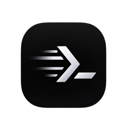

<div align="center">



# Tern

**A fast, native terminal for coding agents, on macOS, Windows and Linux.**

[](https://github.com/cuong95nddev/tern/releases/latest)
[](https://github.com/cuong95nddev/tern/releases)


[**Download**](https://github.com/cuong95nddev/tern/releases/latest) · [Website](https://cuong95nddev.github.io/tern/) · [Releases](https://github.com/cuong95nddev/tern/releases)

</div>

---

Tern runs Claude Code, OpenCode, Codex or any other CLI agent next to the code it changes: a file explorer, a viewer with diffs against `HEAD`, and the git changes of every repository under the opened folder, all in one window. It is written in Rust and rendered on the GPU.

## Features

- **Agent and shell tabs** side by side, in one workspace of the folders you add: each folder with its own files, git changes and terminals
- **File explorer** and a light editor that saves, diffs against `HEAD` and renders Markdown
- **Changes panel** listing the git changes of every repo under the folder; click a file to preview its diff
- **Scratch files** that save as you type
- **Session restore**: the workspace's folders and tabs come back on launch, on the display where you left them
- **Screenshots for agents**: <kbd>⌘</kbd><kbd>⇧</kbd><kbd>2</kbd> (<kbd>Ctrl</kbd><kbd>Shift</kbd><kbd>2</kbd> on Windows) anywhere freezes the screen; pick a region, mark it up (boxes, arrows, text, numbered markers, mosaic), collect a few, add a prompt and send them all to an agent tab (or a new Claude Code, Codex or OpenCode tab). On macOS it needs Screen Recording access. Not on Linux yet.
- **Background sessions**: terminals keep running after you quit, and reattach on the next launch
- **Themes and settings** in plain files: colors, fonts and sizes, applied as you save, easy for an agent to edit
- **Automatic updates**: Tern checks for new releases and installs them in place, keeping your session (macOS; on Windows once the installer is code-signed)

## Install

### macOS

1. Download the latest `.dmg` from [Releases](https://github.com/cuong95nddev/tern/releases/latest).
2. Open it and drag **Tern** onto **Applications**.

To open folders from the shell, save this as `~/.local/bin/tern` and make it executable (`chmod +x`):

```sh
#!/bin/sh
dir=$(cd "${1:-.}" && pwd) || exit 1
exec open -a Tern "$dir"
```

Then run `tern ~/code/my-project`. Dropping a folder on the Dock icon works too.

### Windows (10 1809+ / 11, x64)

Run `Tern-x.y.z-windows-x64-setup.exe` from [Releases](https://github.com/cuong95nddev/tern/releases/latest).
It installs for your user without admin rights (into `%LOCALAPPDATA%\Programs\Tern`), and can add the `tern`
command to PATH (`tern C:\code\my-project`) and **Open in Tern** to the Explorer folder menu. The installer isn't
code-signed yet, so SmartScreen asks first (**More info ▸ Run anyway**).

Shell tabs run PowerShell 7 (`pwsh`) when installed, else Windows PowerShell; Claude tabs run `claude` through it.

### Linux (x86_64)

```sh
tar xzf Tern-x.y.z-linux-x86_64.tar.gz
Tern-x.y.z/install.sh          # tern in ~/.local/bin, menu entry and icons; --uninstall removes them
```

Needs a Vulkan driver (Mesa is fine) and X11 or Wayland. Updates aren't installed automatically: Tern points to the release.

## Keyboard shortcuts

On Windows and Linux, Ctrl chords stay with the terminal (Ctrl+C, Ctrl+R, …), so <kbd>⌘</kbd> becomes
<kbd>Ctrl</kbd><kbd>Shift</kbd>, <kbd>⌘</kbd><kbd>⇧</kbd> becomes <kbd>Ctrl</kbd><kbd>Alt</kbd><kbd>Shift</kbd>,
<kbd>⌘</kbd><kbd>⌥</kbd> becomes <kbd>Ctrl</kbd><kbd>Alt</kbd> and <kbd>⌘</kbd><kbd>1</kbd>…<kbd>9</kbd> become
<kbd>Alt</kbd><kbd>1</kbd>…<kbd>9</kbd> (copy / paste: <kbd>Ctrl</kbd><kbd>Shift</kbd><kbd>C</kbd> / <kbd>V</kbd>,
also <kbd>Ctrl</kbd><kbd>Insert</kbd> / <kbd>Shift</kbd><kbd>Insert</kbd>; next / previous tab also
<kbd>Ctrl</kbd><kbd>Tab</kbd> / <kbd>Ctrl</kbd><kbd>Shift</kbd><kbd>Tab</kbd>). Links open with <kbd>Ctrl</kbd>-click.
Tooltips show each platform's keys.

| Keys (macOS) | Action |
|---|---|
| <kbd>⌘</kbd><kbd>T</kbd> / <kbd>⌘</kbd><kbd>⇧</kbd><kbd>T</kbd> | New Claude tab / shell tab |
| <kbd>⌘</kbd><kbd>O</kbd> | Add a folder to the workspace |
| <kbd>⌘</kbd><kbd>N</kbd> | New scratch file |
| <kbd>⌘</kbd><kbd>B</kbd> | Toggle explorer |
| <kbd>⌘</kbd><kbd>⇧</kbd><kbd>G</kbd> | Toggle Changes panel |
| <kbd>⌘</kbd><kbd>⇧</kbd><kbd>D</kbd> | Diff the open file against `HEAD` |
| <kbd>⌘</kbd><kbd>⇧</kbd><kbd>V</kbd> | Toggle Markdown preview |
| <kbd>⌘</kbd><kbd>⇧</kbd><kbd>O</kbd> | Open the file in VS Code or Cursor |
| <kbd>⌘</kbd><kbd>⇧</kbd><kbd>2</kbd> | Capture a screenshot for an agent (works from any app; <kbd>Ctrl</kbd><kbd>Shift</kbd><kbd>2</kbd> on Windows, also **File ▸ Capture Screenshot**) |
| <kbd>⌘</kbd><kbd>K</kbd> <kbd>⌘</kbd><kbd>T</kbd> | Pick a theme |
| <kbd>⌘</kbd><kbd>,</kbd> | Open `settings.json` |

## Background sessions

Terminals run in a small background process (`tern --server`, started by Tern), so quitting Tern, an update or a crash doesn't stop them: at the next launch every tab comes back attached to the same program, with its screen and scrollback. While Tern is closed, a Claude turn that finishes or needs approval still posts a notification (macOS). Closing a tab ends its program; closing the window quits Tern, and its programs keep running.

The background process quits by itself once no tab is left. Its log is `daemon.log` in `~/Library/Logs/Tern` (macOS),
`~/.local/state/tern` (Linux) or `%LOCALAPPDATA%\Tern\logs` (Windows). To end it and everything running in it:
`pkill -f 'tern --server'` (macOS, Linux), or end `tern-server-x.y.z-pN.exe` in Task Manager (Windows, where it runs from a copy
in `%LOCALAPPDATA%\Tern\mux`, so updates can replace `tern.exe` while it runs).

On Windows it talks over an AF_UNIX socket and runs programs in ConPTY; who runs in a tab is found from the shell's pid.

On macOS, a menu bar icon lists every terminal running in the background, also while Tern is closed: the count beside it, a dot when one waits for you. Pick one to open it in Tern (as a tab of the workspace) or end it. Hide it from its own menu or with Tern ▸ Hide Menu Bar Icon. Its log is `~/Library/Logs/Tern/menubar.log`.

## Remote access (browser)

`tern --web` serves Tern's terminals to a browser on another device, to watch a coding agent and answer it away from the desk. It is meant for a private network such as [Tailscale](https://tailscale.com): by default it listens on this machine's Tailscale address (else only on `127.0.0.1`), on port 7317, and prints a secret link and its QR code. Open the link once on the phone or other computer; the browser stays signed in for 30 days.

The page lists the terminals (the ones that wait for you first), shows one with its scrollback and lets you type into it, with keys for Esc, Tab, arrows and Ctrl+C and a message box on phones. Tern keeps its tabs: the browser watches beside it. **Fit** makes the terminal the screen's size while you look at it, and gives it back its size when you leave.

```
tern --web [--bind <address>] [--port <port>] [--new-token]
```

`--bind 0.0.0.0` listens on every network (it is plain HTTP: only on a network you trust); `--new-token` makes a new link, and old ones stop working. On Windows, run it from `tern.exe` in a terminal. It needs the background process of the same Tern version.

## Themes and settings

Settings live in `~/.config/tern` (macOS, Linux; `XDG_CONFIG_HOME` if set) or `%APPDATA%\Tern` (Windows). Saving a file
there applies it at once; if it can't be read, Tern keeps what it applied last and says why in the status bar.

- `settings.json`: the theme (`"Tern Dark"`, `"Tern Light"` or one of yours), the UI, editor and terminal fonts, UI
  colors over the theme's by key, terminal colors, and the look of each part of the window. Every element (a panel, its
  rows, a bar) has its own properties (height, paddings, font size, colors, a background image); by default they point
  at shared tokens like `$row_height`, so change a token to restyle every element that uses it, or one element's
  property to restyle just that one. `reference/elements.md` lists them all.
- `themes/*.json`: your themes, in [gpui-component](https://github.com/longbridge/gpui-component)'s theme format plus a
  `terminal` palette. `reference/` has the built-in ones to copy from.
- `settings.schema.json` (every key and what it does) and `README.md`, which Tern rewrites on each start.

<kbd>⌘</kbd><kbd>K</kbd> <kbd>⌘</kbd><kbd>T</kbd> picks a theme, showing each as you move through the list;
<kbd>⌘</kbd><kbd>,</kbd> opens `settings.json` in a tab.

Ask an agent in a Tern tab to "make the terminal background navy" and it can do it from those files.

## Updates

Tern checks for a new release at launch and every 6 hours. When one is available, **Update to x.y.z** appears in the status bar (also under **Tern ▸ Check for Updates…** on macOS, **Help ▸ Check for Updates…** on Windows and Linux). Set `TERN_NO_UPDATE_CHECK=1` to turn this off.

## Building from source

Requires a recent stable Rust.

```sh
cargo run --release -p tern-app -- /path/to/project
scripts/install-macos.sh      # macOS: /Applications/Tern.app plus a `tern` command in ~/.local/bin
scripts/release-windows.ps1   # Windows: the installer, in target\dist (needs Inno Setup 6)
scripts/release-linux.sh      # Linux: the archive, in target/dist
```

On Linux install GPUI's build dependencies first (Debian/Ubuntu names in `packaging/linux/build-deps.txt`):
`sudo apt-get install $(cat packaging/linux/build-deps.txt)`.

From macOS, `cargo xwin check --target x86_64-pc-windows-msvc --workspace` type-checks the Windows build
([cargo-xwin](https://github.com/rust-cross/cargo-xwin), plus Homebrew `llvm` on PATH for `llvm-rc`).

Crates: `tern-term` (VT core, snapshots), `tern-mux` (background daemon: PTYs, protocol, client), `tern-menubar` (menu bar agent; macOS), `tern-fs` (tree, watcher, git),
`tern-bridge` (Claude Code hook receiver), `tern-app` (UI).

The app icon lives in `assets/icon/source.png`; `scripts/gen-icons.sh` (ImageMagick) regenerates every size from it into `assets/icon/`: macOS `.icns` and an Icon Composer `Tern.icon` (compiled by the install script with Xcode's `actool`, so macOS 26 shows it full-size instead of shrunk into a gray tile), iOS `AppIcon.appiconset` (with dark and tinted looks), Android `res/` (legacy, round, adaptive and monochrome launcher icons, Play Store 512), web favicons/PWA icons, the Windows `tern.ico` (linked into `tern.exe` by `crates/tern-app/build.rs`) and Linux hicolor PNGs.

The website lives in `site/` and is published to GitHub Pages by `.github/workflows/pages.yml`.

### Releasing

Releases are built by `.github/workflows/release.yml` when a `v*` tag matching
the Cargo.toml version is pushed: the macOS DMG, the Windows installer and the Linux archive
(`scripts/release-{macos.sh,windows.ps1,linux.sh}` build the same files locally).
`.github/workflows/ci.yml` runs fmt, clippy and the tests on all three platforms for every pushed branch and every PR.
The workflow signs with Developer ID and notarizes when these repository secrets are set
(otherwise the app is ad-hoc signed and needs `xattr -dr com.apple.quarantine /Applications/Tern.app`):
`MACOS_CERT_P12` (base64 of the exported "Developer ID Application" `.p12`), `MACOS_CERT_PASSWORD`,
`MACOS_SIGN_ID` (the identity's full name), and for notarization an App Store Connect API key:
`NOTARY_KEY` (base64 of the `.p8`), `NOTARY_KEY_ID`, `NOTARY_ISSUER`.

The app finds the latest release anonymously from github.com's `/releases/latest` redirect (not the rate-limited REST API)
and expects each platform's file named as the release scripts name them. On Windows, Tern installs an update itself only
when built with `TERN_WINDOWS_SIGNER` (repository variable `WINDOWS_SIGNER`: the code-signing certificates' SHA-1 thumbprints, comma separated) and the
downloaded installer carries a valid Authenticode signature from one of them; the installer isn't signed yet, so until then Windows
users get the release page. To publish releases to another repo, set the repository
variable `RELEASE_REPO` and the secret `RELEASE_TOKEN` (a fine-grained token with Contents read/write on it).

Windows signing goes through [SignPath](https://signpath.org) (see [Code signing policy](#code-signing-policy)). With the
repository variable `SIGNPATH_ORGANIZATION_ID` and the secret `SIGNPATH_API_TOKEN` set, the release workflow has
SignPath sign `tern.exe`, packs it into the installer and has the installer signed; each request waits for approval
in SignPath. The project there needs the artifact configurations in `packaging/windows/signpath/` (slugs `tern-exe`,
`tern-setup`), project slug `tern` and signing policy `release-signing` (or set `SIGNPATH_PROJECT_SLUG` /
`SIGNPATH_POLICY_SLUG`). Then set `WINDOWS_SIGNER` to the certificate's thumbprint so Tern installs updates itself.

## Reference

Tern has one window and one workspace: the folders you add to it, with their tabs. It reopens the last session, where it was (`~/Library/Application Support/dev.tern/session`); a session from an older build (several windows and workspaces) becomes one workspace of all their folders and tabs. `tern <folder>` adds the folder to the workspace in the running Tern (or launches it with the session restored); so does dropping a folder on the Dock icon. With no folder and no tab, the window shows a welcome page (Add Folder…, recent folders).

Each folder is a top-level row in the explorer; the Changes panel lists the git repos of every folder, folder by folder; a terminal starts in a folder (the active tab's, or the one you pick: **New Tab in Folder** in the + menu, **New Claude/Shell Tab Here** in the explorer's right-click menu) and is reopened there. Right-click a folder's row for **Remove Folder from Workspace** (its tabs stay).

| Keys | Action |
|---|---|
| ⌘O | Add folders to the workspace (also the explorer's folder button, the + menu and File ▸ Open Recent); one already in is revealed in the explorer |
| ⌘T / ⌘⇧T | New Claude tab / shell tab in the active tab's folder (also in the tab bar's + menu) |
| ⌘N | New scratch file (IntelliJ-style): kept in `~/Library/Application Support/dev.tern/scratches`, saved as you type; other types and reopening old scratches are in the + menu. Closing an empty one deletes it |
| ⌘W, ⌘1–9, ⌘⇧[ ⌘⇧] | Close / switch tabs (or the × on each tab) |
| Right-click a tab | Close / Close Others / Close to the Right / Close File Tabs, Rename… (terminal title or scratch file name), Copy Path, Reveal in Finder |
| Drag a tab onto a pane | Split the editor area like VS Code: drop near an edge to open a new pane on that side, in the middle to move the tab into that pane. A pane closes when its last tab leaves |
| ⌘\\ / ⌘⇧\\ | Split right / down (moves the tab; a pane's only tab gets a new terminal of its kind beside it). Also in the tab's right-click menu: Split Left/Right/Up/Down |
| Pane Layout (grid button, + menu) | Presets for big screens: 2/3/4 columns, 2/3 rows, grids 2×2, 3×2, 4×2, 3×3 (new panes start empty); **Tile All Tabs** gives each tab its own pane; Even Pane Sizes |
| ⌃⌘←→↑↓ | Focus the pane on that side; ⌘1–9, ⌘W and ⌘⇧[ ] act on the focused pane's tabs |
| ⌘⇧↩ | Maximize the focused pane / restore the others |
| ⌘K ⌘T | Pick a theme (also Tern ▸ Theme…): moving through the list shows each one, ↩ saves it in `settings.json`, Esc goes back. In a terminal, ⌘K alone still clears it once the second key doesn't come |
| ⌘, | Open `settings.json` in a tab (also Tern ▸ Settings…) |
| ⌘-hover / ⌘-click in a terminal | Underline / open the link under the mouse: a URL (in the browser), an OSC 8 hyperlink, or a file path that exists (`src/main.rs:42:7` opens it in a tab at that line; relative paths resolve against the folder of the program running in the terminal, e.g. Claude Code's). A folder is revealed in the explorer |
| ⌘B | Toggle explorer (or the panel buttons at the right of the tab bar) |
| click in Changes | Preview the file's diff in a popup; **Open in Tab** moves it to a center tab |
| ⌘⇧G | Toggle Changes panel (git changes of every repo under the workspace's folders) |
| ⌘⇧S | Toggle Scratches panel (under the explorer): every scratch file, newest first; click to open, right-click for Copy Path / Reveal in Finder / Delete… |
| ⌘⇧D | Toggle diff vs HEAD for the open file |
| ⌘⇧V | Toggle rendered Markdown preview (`.md` files open in preview; relative links open in the viewer) |
| ⌘⇧O | Open current file in VS Code / Cursor |
| ⌘S | Save file in viewer (scratches save themselves) |
| ⌘C / ⌘V / ⌘K | Copy / paste / clear terminal |

The window reopens on the display, position and size it last had (`~/Library/Application Support/dev.tern/window`).

Debug builds can be driven without the real mouse/keyboard: run with
`TERN_CONTROL=tern.sock` (a short path; Unix sockets cap it at 104 bytes) and
send line commands to that socket — `click X Y` / `rclick X Y` (window coordinates),
`key escape` / `key cmd-w`, `state` (tabs, active tab, dialog open, viewer mode, scratch count or -1 when hidden),
`scratch-new EXT` / `scratch-open NAME` (what the + menu does), `scratch-text TEXT` (replace
the active scratch tab's text; `\n` for newlines), `ws` (the folders), `ws-open PATH` /
`ws-remove PATH` (add a folder / take it out). Scripted runs
neither restore nor save the session unless `TERN_SESSION=1` (pair it with a scratch `HOME`). Pair with
`screencapture -l <window id>` to see the result.

## Code signing policy

Windows releases are signed once SignPath approves the project: free code signing provided by
[SignPath.io](https://about.signpath.io), certificate by [SignPath Foundation](https://signpath.org).

- Committers and reviewers: [@cuong95nddev](https://github.com/cuong95nddev)
- Approvers: [@cuong95nddev](https://github.com/cuong95nddev)

Only builds made by `.github/workflows/release.yml` from this repository's sources are signed, and every
release is approved by hand before it is.

## Privacy

Tern sends nothing about you or your files anywhere. Its only network request of its own is the update check:
anonymous requests to github.com for this repository's latest release (`TERN_NO_UPDATE_CHECK=1` turns it off).
`tern --web`, when you run it, serves your terminals to browsers that have its secret link; it calls nothing outside.
Programs you run in its terminals, such as Claude Code, follow their own privacy policies.

## Feedback

Found a bug or have an idea? [Open an issue](https://github.com/cuong95nddev/tern/issues). Tern is MIT licensed, see [LICENSE](LICENSE).
